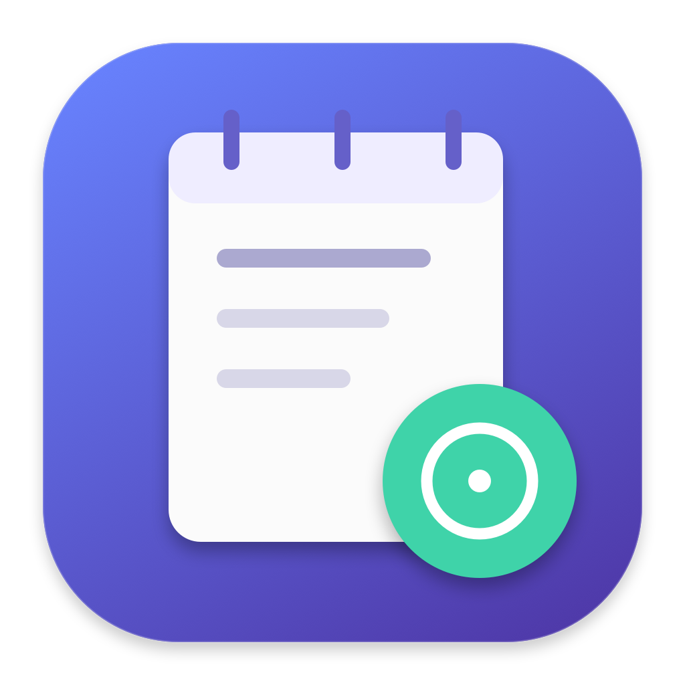
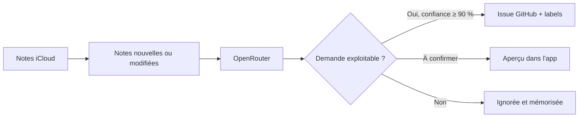

# Note to Issue



**Écris dans Apple Notes. Retrouve une issue GitHub claire, structurée et étiquetée.**

Une app macOS native qui surveille tes notes iCloud, reconnaît les bugs et les améliorations avec OpenRouter, puis crée automatiquement les issues dans le dépôt choisi.

SwiftUI · macOS 14+ · aucune dépendance Swift externe · aucun serveur à héberger

## Comment ça marche



- Reformule le titre et la description sans inventer les détails manquants.
- Choisit les labels parmi ceux qui existent déjà dans le dépôt.
- Utilise `kroco-edu/app` par défaut, configurable dans les réglages.
- Une directive dans la note permet de choisir un autre dépôt.
- Conserve la note originale et affiche les propositions, résultats et erreurs dans l'app.
- Reste active dans la barre des menus quand la fenêtre est fermée et peut se relancer à l'ouverture de session.

## Installation

Prérequis : macOS 14 ou plus récent, les outils Swift/Xcode, Apple Notes connecté à iCloud, un compte OpenRouter avec du crédit et GitHub CLI déjà authentifié.

```sh
# Si nécessaire
xcode-select --install
brew install gh
gh auth login

git clone https://github.com/remimenguy/note-to-issue.git
cd note-to-issue
./script/install.sh
```

Le script construit et installe `~/Applications/NoteToIssue.app`, puis l'ouvre. Le code peut rester sur un disque externe : l'app installée fonctionne indépendamment de ce disque. Les fichiers de compilation vont dans `~/Library/Caches/NoteToIssue/Build`.

### Première connexion

1. Ouvre **Réglages → OpenRouter → Connecter OpenRouter**.
2. Autorise la connexion dans ton navigateur. L'app utilise OAuth PKCE S256 : aucun secret client à configurer, aucune clé à copier. Le retour local se ferme après la connexion ou au bout de 3 minutes.
3. Vérifie le compte Notes (`iCloud` par défaut) et, éventuellement, limite la surveillance à un dossier. Un compte renommé commençant par « iCloud » est reconnu automatiquement s'il est unique ; sinon, saisis son nom exact dans Apple Notes.
4. Clique **Vérifier l'accès à Notes** et autorise l'automatisation macOS.
5. Enregistre les réglages. La surveillance démarre automatiquement quand OpenRouter est connecté.

GitHub utilise la session existante de `gh` ; aucun token GitHub supplémentaire n'est demandé. Le compte connecté doit pouvoir créer des issues et appliquer des labels dans le dépôt cible. Pour une organisation avec SSO, autorise aussi la session GitHub CLI pour cette organisation.

## Écrire une note

```text
Le bouton de connexion ne répond plus sur Safari

Après avoir saisi mon e-mail, cliquer sur Se connecter ne fait rien.
Il faudrait afficher une erreur si la connexion échoue et permettre de réessayer.
```

Cette note peut devenir une issue avec un titre concis, une description Markdown et des labels comme `bug` ou `enhancement`, s'ils existent dans le dépôt.

Pour choisir une destination :

```text
repo: mon-organisation/mon-projet

Le formulaire de recherche ne répond pas sur mobile.
```

`repository: owner/name`, `dépôt: owner/name`, `dans le repo owner/name` et `create issue in owner/name` sont également acceptés. Une simple mention d'un dépôt ne change pas la destination. Les directives mal formées ou contradictoires bloquent la note.

Une note produit au maximum une issue. Pour une nouvelle demande après publication, crée une nouvelle note. Modifier une note déjà publiée ne crée ni seconde issue ni mise à jour automatique de l'issue existante.

## Automatisation et ressources

La surveillance vérifie les identifiants et dates de modification toutes les 60 secondes par défaut. Seul le texte des notes nouvelles ou modifiées est récupéré. Un lot contient au maximum 10 notes, traitées une par une. Les notes encore modifiées depuis moins de 30 secondes attendent le passage suivant.

- Aucun modèle IA local, navigateur intégré, conteneur ou serveur permanent.
- Aucun appel OpenRouter pour une note déjà analysée et inchangée.
- Intervalle réglable à 1, 5, 15 ou 60 minutes ; 5 minutes réduit encore les réveils.
- Une pause est conservée au redémarrage.
- Fermer la fenêtre garde l'app active. **Quitter** l'arrête.
- Le lancement automatique utilise les éléments d'ouverture natifs de macOS. S'il faut une approbation, active Note to Issue dans **Réglages Système → Général → Ouverture et extensions**.
- Le Mac doit être allumé et la session ouverte. Pendant la veille, aucun traitement ne s'exécute ; il reprend au réveil. L'app ne maintient pas le Mac éveillé.

Le mode **aperçu**, dans les réglages, désactive la publication automatique. Les détections sous 90 % de confiance restent en attente de validation, y compris en mode automatique.

## Confidentialité et secrets

L'application et le journal tournent sur ton Mac. L'analyse IA utilise les serveurs OpenRouter : le texte des notes analysées, le dépôt choisi et ses labels leur sont transmis. Ce n'est donc pas une IA hors ligne. Le routage demande des fournisseurs n'autorisant pas la collecte des données (`data_collection: deny`) ; les politiques de ton compte OpenRouter et du fournisseur restent applicables.

Le secret obtenu par OAuth reste dans le **Trousseau macOS**, avec une entrée dédiée `com.remimenguy.NoteToIssue` / `openrouter`. Le vérificateur PKCE n'existe qu'en mémoire pendant la connexion. GitHub CLI gère sa propre authentification.

Le journal privé contient les notes analysées, les propositions et les URLs des issues :

```text
~/Library/Application Support/NoteToIssue/state.json
```

Son dossier est limité à ton utilisateur (`0700`) et le fichier à `0600`. Les réglages non secrets utilisent les préférences macOS. Aucun contenu de note, token ou réponse brute de service n'est journalisé dans la console par l'app.

Le dépôt ne contient aucun secret. `.env`, `.env.*`, clés, certificats, builds, journaux et données locales sont exclus de Git. Aucun fichier `.env` n'est nécessaire au fonctionnement.

## Doublons et erreurs

Chaque issue reçoit un marqueur HTML discret dérivé de l'identifiant de la note. Avant de publier, l'app recherche ce marqueur dans les issues du dépôt, **ouvertes et fermées**, avec pagination. Le contrôle est mémorisé brièvement pendant un lot pour limiter les requêtes.

L'intention de publication est enregistrée sur disque **avant** l'envoi. Si la réponse GitHub est perdue ou si l'app s'arrête pendant l'envoi, la note passe en **Publication à vérifier**. Elle n'est jamais republiée automatiquement. Le bouton **Vérifier GitHub** permet de retrouver l'issue créée. Si aucune issue n'est trouvée, elle reste bloquée : vérifie le dépôt avant toute intervention sur le journal.

Un verrou empêche deux instances sur le même Mac de publier en parallèle. Ce mécanisme ne coordonne pas plusieurs Macs : utilise une seule installation active pour un même compte Notes. Ne supprime pas le journal pour résoudre une erreur ; conserve une copie avant toute réparation.

Les erreurs sur une note sont visibles et peuvent être relancées manuellement. Une erreur ne supprime pas les traitements déjà enregistrés. Un journal corrompu bloque la publication.

## Développement

```sh
swift test
./script/build_and_run.sh             # construire et ouvrir
./script/build_and_run.sh --verify    # vérifier le processus après lancement
./script/build_and_run.sh --build-only
./script/build_and_run.sh --logs
open dist/NoteToIssue.app --args --demo
```

La démo utilise des données fictives : aucune lecture de Notes et aucun appel réseau. Pour tester l'installation complète, utilise `./script/install.sh`.

```text
Sources/NoteToIssue/          App SwiftUI, vues, état de l'interface
Sources/NoteToIssueCore/      Routage, journal, moteur, Notes, OpenRouter, OAuth, GitHub
Tests/NoteToIssueCoreTests/   Tests de comportement et de contrats des services
script/                      Construction et installation reproductibles
```

Les tests couvrent notamment le routage, le cache, les labels, le journal atomique, les publications incertaines, PKCE et le récepteur OAuth local. Les services externes sont simulés ; les tests ne créent aucune issue réelle et n'envoient aucune note à l'IA. Le workflow GitHub Actions construit et teste sur macOS.

Le bundle est signé localement avec une signature ad hoc, sans notarisation de distribution. Reconstruire l'app peut conduire macOS à redemander l'accès à Notes ou au Trousseau. Une distribution binaire publique nécessiterait une signature Developer ID et une notarisation.

## Limites actuelles

- Texte des notes seulement : pas d'OCR, de lecture de pièces jointes ou de notes verrouillées. Le dossier **Supprimées récemment / Recently Deleted** est toujours exclu, avant la lecture du texte.
- Notes déjà synchronisées dans Apple Notes sur le Mac ; l'app n'interroge pas directement les serveurs iCloud.
- Maximum 24 000 caractères par note ; les textes plus longs sont signalés sans envoi à l'IA.
- Le filtre de dossier utilise un nom exact et unique parmi les dossiers du compte.
- Une seule issue par note, sans synchronisation ultérieure des éditions.
- Le modèle configurable doit prendre en charge les sorties structurées JSON Schema. Modèle initial : `openrouter/free`. Les modèles gratuits peuvent être limités ou temporairement indisponibles ; une erreur reste visible dans l'app.

## Références

- [OAuth PKCE OpenRouter](https://openrouter.ai/docs/guides/overview/auth/oauth)
- [Sorties structurées OpenRouter](https://openrouter.ai/docs/guides/features/structured-outputs)
- [GitHub CLI](https://cli.github.com/manual/)
